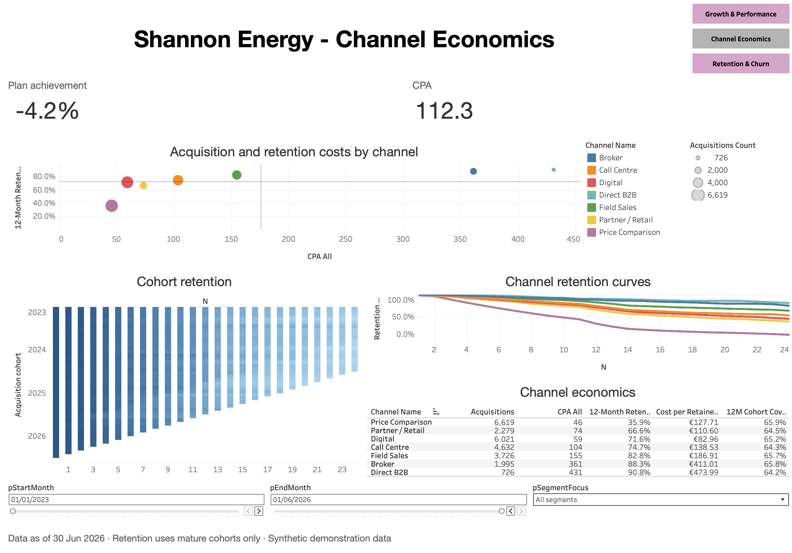
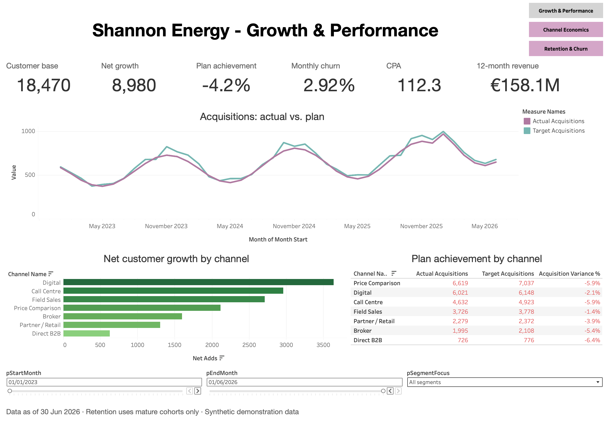
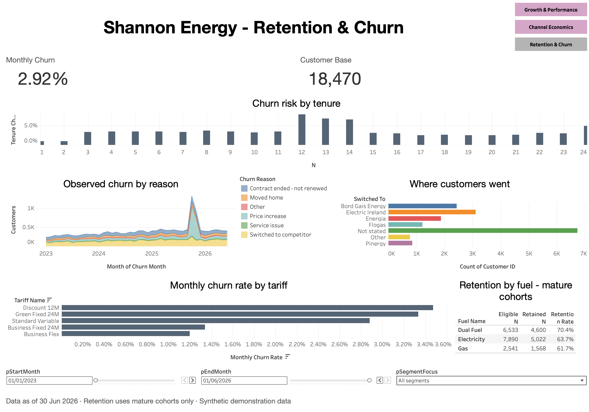

# Shannon Energy - Growth, Channel Economics & Retention

A Tableau analysis of customer acquisition, channel profitability and retention for a
fictional Irish energy retailer. Built end to end: raw data audit → reproducible cleaning
pipeline → data model → calculated fields → three interactive dashboards → business
recommendations.

**[▶ Open the interactive dashboard on Tableau Public](https://public.tableau.com/views/ShannonEnergy-GrowthChannelEconomicsRetention/GrowthPerformance)**

---

## The headline finding

**The cheapest channel to acquire from is one of the most expensive channels to keep
a customer from.**

Price Comparison has the lowest cost per acquisition in the business at €46 - less than
a seventh of what a Direct B2B customer costs. On a CPA league table it wins outright.

But only 35.9% of its customers are still there twelve months later. Once retention is
priced in, each *surviving* Price Comparison customer costs **€127.71** - against
**€82.96** for Digital, a channel whose CPA is 28% higher.

Ranking channels on acquisition cost alone points the budget at the worst-performing
source of customers in the portfolio.



---

## Business problem

Shannon Energy is growing its customer base but missing its acquisition plan, and
leadership cannot answer three questions from the existing reporting:

1. **Which channels actually create value**, once customers who leave are accounted for?
2. **When and why do customers churn**, and is the risk evenly spread across tenure?
3. **Is the acquisition plan realistic**, and where is the shortfall concentrated?

The analysis is aimed at a commercial director deciding where next year's acquisition
budget goes, and at a retention lead deciding where to intervene.

---

## Dashboards

### 1. Growth & Performance

Executive view: customer base, net growth, plan achievement, churn, CPA and rolling
12-month revenue, with acquisitions against plan over time and channel-level variance.



### 2. Channel Economics

The core analytical page. Acquisition cost plotted against 12-month retention, with
retention curves by channel and a full economics table that carries CPA, retention and
cost per retained customer side by side.

### 3. Retention & Churn

Churn risk by tenure month, churn reasons over time, where leaving customers go, churn
rate by tariff and retention by fuel type.



---

## Key findings

Findings are labelled by how strongly the data supports them. This distinction is kept
throughout the project.

### FACT - directly supported by the data

| Channel | Acquisitions | CPA | 12-month retention | Cost per retained customer |
|---|---:|---:|---:|---:|
| Price Comparison | 6,619 | €46 | 35.9% | €127.71 |
| Digital | 6,021 | €59 | 71.6% | **€82.96** |
| Partner / Retail | 2,279 | €74 | 66.6% | €110.60 |
| Call Centre | 4,632 | €104 | 74.7% | €138.53 |
| Field Sales | 3,726 | €155 | 82.8% | €186.91 |
| Broker | 1,995 | €361 | 88.3% | €411.01 |
| Direct B2B | 726 | €431 | 90.8% | €473.99 |

- **Digital is the most efficient channel** on cost per retained customer (€82.96), not
  the channel with the lowest CPA.
- **Ranking by CPA and ranking by cost per retained customer disagree**: Price Comparison
  moves from 1st to 5th of seven once retention is applied.
- **Churn risk is not flat across tenure.** It sits near 3% for most months, then rises
  sharply at months **12, 13 and 14** before falling back.
- **Dual Fuel customers retain best** (70.4%), ahead of Electricity (63.7%) and Gas (61.7%).
- **Discount 12M carries the highest monthly churn rate** of any tariff; Business Flex the
  lowest.
- **Every channel missed its acquisition target**, with an overall shortfall of 4.2%.
  Direct B2B is furthest behind at −6.4%, Field Sales closest at −1.4%.
- Blended monthly churn is **2.92%**; rolling 12-month revenue is **€158.1M**.

### INFERENCE - a reasonable reading of the data

- The channels that convert cheapest appear to attract the most price-driven customers.
  Retention falls monotonically as CPA rises across six of the seven channels, which is
  consistent with higher-touch channels selecting for less price-sensitive customers.
- The revenue table does not cover the full customer base (peak closing base 18,470
  against 40,998 customers in the customer dimension), so revenue-derived metrics describe
  the billed population rather than every customer on file.

### HYPOTHESIS - requires further investigation

- The churn spike at months 12–14 **coincides with** the expiry of 12-month contracts, and
  Discount 12M is the worst-performing tariff for churn. This is a plausible explanation,
  **not a demonstrated cause** - the data contains no renewal event, no price-change date
  and no competitor pricing, so causality cannot be established here.

---

## Recommendations

1. **Re-base channel budgeting on cost per retained customer, not CPA.** On current
   figures that means shifting spend from Price Comparison toward Digital, which delivers
   a retained customer for 35% less.
2. **Build a retention intervention at month 10–11**, ahead of the observed 12–14 month
   spike rather than after it.
3. **Treat the Discount 12M tariff as a retention problem, not a pricing success.** It
   acquires well and loses customers faster than any other tariff.
4. **Investigate the contract-expiry hypothesis properly** by capturing renewal offers,
   price changes at renewal and outcomes. Until then it should not be presented to
   leadership as the cause.
5. **Fix the `SwitchedTo` capture.** 6,742 of 17,018 churn events - 40% - have no
   destination recorded, which makes competitor analysis unreliable.

---

## Methodology

### Data preparation

All cleaning is done in `scripts/prepare_data.py`, which is reproducible and self-checking.
It documents every decision and ends by asserting **14 control values**; the run fails
loudly if any of them drifts.

Issues found and handled:

| Issue | Rows | Treatment |
|---|---:|---|
| Exact duplicate acquisitions | 240 | Removed |
| Acquisition cost stored as text with `€` | 1,623 | Parsed to numeric |
| Channel names with inconsistent spellings | 15 variants | Mapped to 7 canonical codes |
| Missing region | 300 | Flagged `UNK`, customers retained |
| Mixed date formats (ISO and `DD/MM/YYYY`) | 2,484 | Parsed explicitly, not inferred |
| Missing churn destination | 6,742 | Flagged `Not stated` |
| Churn events with no matching acquisition | 5,967 | Flagged channel `LEG`, **retained** |

Nothing was silently dropped. See [`docs/data_quality_report.md`](docs/data_quality_report.md).

### The churn-rate bug worth describing

An early version of the monthly churn rate returned **1.92%**. The correct figure is
**2.92%** - a third of the churn was missing.

Two separate causes:

1. **Eligibility was applied at row level.** The 5,967 legacy churn events (`LEG`) have no
   matching revenue rows, so a row-level filter silently discarded them. Eligibility has to
   be decided at **month** level and the flag pre-computed in the pipeline.
2. **The opening base was lost for disappearing key combinations.** Joining the previous
   month with a left join dropped any combination that existed last month and not this one,
   understating the denominator. An outer join preserves it.

Both fixes are in `prepare_data.py` and documented in
[`docs/metric_dictionary.md`](docs/metric_dictionary.md).

### Data model

Five independent sources at different grains, plus dimension tables.

| Source | Grain |
|---|---|
| `AcquisitionClean` | one row per acquisition (25,998) |
| `MonthlyPerformance` | month × channel × segment × region × tariff × fuel |
| `RetentionCohorts` | cohort × attributes × month-since-acquisition `N` (166,186) |
| `PlanPerformance` | month × channel × segment |
| `ChurnBase` | one row per churn event (17,018) |

**No joins between fact tables.** Their grains differ, and joining them would fan out rows
and inflate every measure. Dimension attributes are denormalised into each fact during
preparation, and cross-source filtering is driven by **parameters** rather than filter
actions, which do not bridge independent sources in Tableau.

### Metric definitions

Every calculated field is documented with its business meaning, its formula, its
aggregation level, its division-by-zero handling and its control value in
[`docs/metric_dictionary.md`](docs/metric_dictionary.md). Three worth calling out:

- **Closing base** is the base of the last observed month, never a sum across months -
  customer counts are a stock, not a flow.
- **Monthly churn rate** sums numerators and denominators separately. Averaging monthly
  percentages weights a small month the same as a large one.
- **Retention** is calculated on **mature cohorts only**. A cohort acquired three months
  before the cut-off cannot yet have a 12-month retention figure, and including it would
  bias the result upward.

---

## Tableau techniques demonstrated

Level of Detail expressions (`FIXED`), parameters and parameter-driven filters, dashboard
navigation actions, highlight actions, reference lines, cohort heatmap, dual-encoded
scatter plot (size and colour), context filters, custom tooltips, multi-source data model,
calculated-field dependency chains, and fixed-date logic (`DataAsOf`) in place of `TODAY()`
so the analysis reproduces identically at any future date.

---

## Repository structure

```
shannon-energy-tableau/
├── data/raw/           11 source CSV files
├── scripts/            reproducible preparation pipeline
│   ├── prepare_data.py cleaning, metric construction, 14 control checks
│   └── denormalize.py  merges dimension attributes into fact tables
├── docs/
│   ├── metric_dictionary.md    every formula, with control values
│   ├── data_quality_report.md  auto-generated by the pipeline
│   └── refresh_instructions.md how to update the data
├── images/             dashboard screenshots
└── workbook/           Tableau workbook source (.twb)
```

## Reproducing the analysis

```bash
python3 scripts/prepare_data.py
```

Requires Python 3 with pandas. The script reads `data/raw/`, writes prepared tables to
`prepared/`, regenerates the data quality report and prints the control-value table. All
14 checks must read `OK`.

Prepared data is **not** committed - it is build output, and the script is the source of
truth. To inspect the workbook with data already attached, download the packaged workbook
directly from the Tableau Public link above.

The `.twb` in `workbook/` stores absolute paths to its data sources, so opening it locally
requires repointing the connections to your own `prepared/` folder.

---

## Limitations

Stated explicitly, because a dashboard that hides them is a dashboard that misleads.

- **No profitability analysis.** The source data contains no cost of goods, so margin and
  contribution cannot be calculated. An earlier draft assumed an 18% margin; that metric was
  removed rather than presented on an assumption.
- **No causal claims.** The analysis identifies when churn happens, not why.
- **No forecasting.** Future periods contain no actuals.
- **No per-customer revenue.** The revenue table carries no customer identifier.
- **Plan exists only at month × channel × segment.** Plan-based KPIs are shown as N/A when
  sliced by region, tariff or fuel rather than being spread across a grain the plan does
  not have.
- **Fixed cut-off date of 30 June 2026.** Deliberate, so the figures remain reproducible.

---

## Companion project

The same raw data is analysed in Power BI in
**[shannon-energy-powerbi](https://github.com/marinakulman/shannon-energy-powerbi)**, where the
cleaning is done in Power Query rather than a Python pipeline, the model is secured with
row-level security, and the measures are written in DAX.

The two projects were built independently and arrive at the same figures - €46 CPA against
35.9% retention for Price Comparison, €128 per retained customer, 2.9% monthly churn.
Reproducing a result by a second route is how the method was checked.

---

## Data

Synthetic demonstration data. It contains no real customers and no personal information.
The company, its customers and the competitors named in the churn data are fictional.

## Author

**Marina Kulman** - Data & BI Analyst, Dublin
[Portfolio](https://marinakulman.github.io/Portfolio/) · [GitHub](https://github.com/marinakulman)
